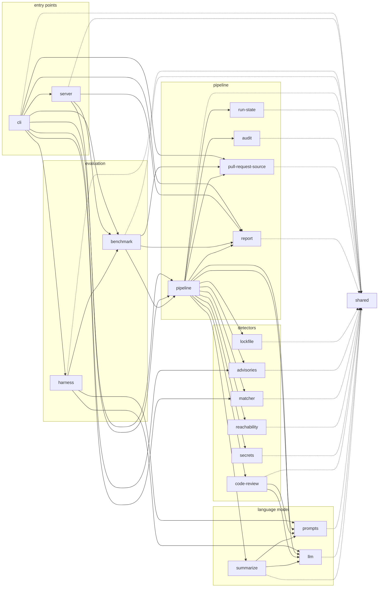
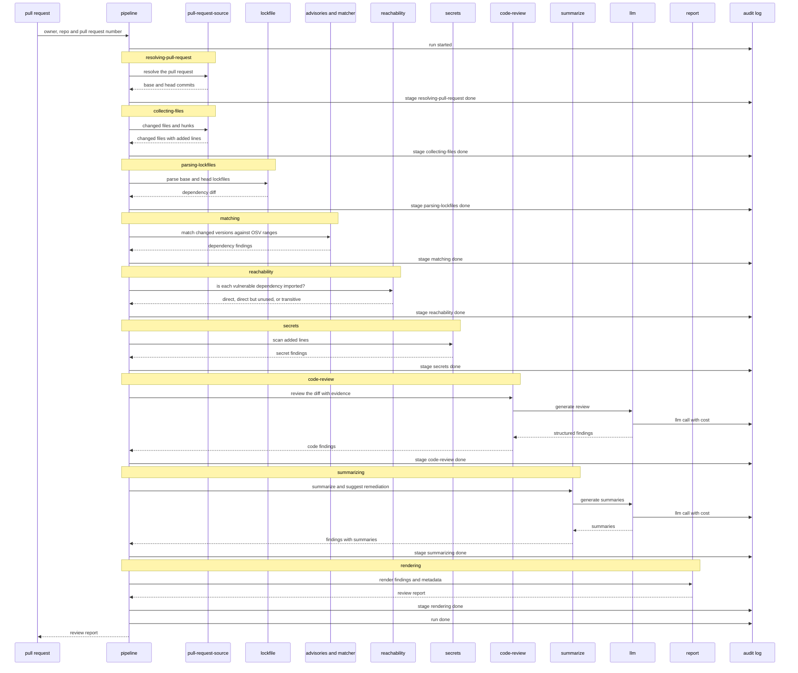
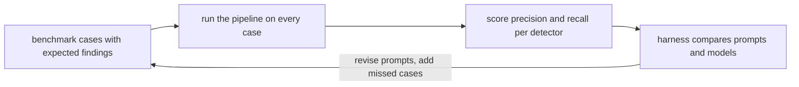

# pr-review

pr-review is an agent that reviews a pull request for security problems in three ways: it diffs the lockfile and matches every new or changed dependency version against OSV advisories, then checks whether the vulnerable code is reachable from the changed project; it asks an LLM to review the diff for security issues and grounds every finding in evidence from the changed lines; and it scans the added lines for secrets. The findings are rendered into a report, every run is written to a per-run audit log, and the whole pipeline is scored against a benchmark of recorded pull requests so prompt and model changes can be compared instead of guessed at.

## Architecture

One Bun process, nineteen modules under `src/`, and an allowed-imports matrix in `.dependency-cruiser.cjs` that a boundary check enforces on every commit. The graph below is that matrix: an arrow from `a` to `b` means `a` may import `b`. Dotted arrows are imports of `shared`, the contracts module everything builds against.



## Pipeline

A review run moves through ordered stages that `run-state` enforces: resolving-pull-request, collecting-files, parsing-lockfiles, matching, reachability, secrets, code-review, summarizing, rendering, done. Every stage change and every LLM call is appended to `runs/<runId>/audit.jsonl` with secret-like values redacted.



## Benchmark loop

The benchmark replays recorded pull requests with known findings through the same pipeline and scores the result. The harness runs that loop for each prompt version and model under comparison, so a change to a prompt or a model swap is measured before it ships.



## How to run

Install the dependencies and copy the environment file. `ANTHROPIC_API_KEY` or `FIREWORKS_API_KEY` is needed for whichever provider the model ids in `config/models.json` name. `GITHUB_TOKEN` is optional: without it public pull requests work under GitHub's limit of 60 API requests an hour.

```bash
bun install
cp .env.example .env
```

Download the OSV npm advisories once. A review refreshes them on its own when the snapshot is older than `advisoryStaleHours` in `config/review.json`.

```bash
bun index.ts refresh-advisories
```

Review a pull request by url or by `owner/repo#number`:

```bash
bun index.ts review https://github.com/owner/repo/pull/123
bun index.ts review owner/repo#123 --format json --fail-on high
GITHUB_TOKEN= bun index.ts review owner/repo#123
bun index.ts review owner/repo#123 --no-llm
```

A review writes `runs/<runId>/report.html` (or `report.json`) next to `runs/<runId>/audit.jsonl`, prints the report as a `file://` link and one line of counts. It exits 1 when an introduced finding is at or above `--fail-on`, and 2 when the run could not finish. `--no-llm` needs no key: code review is skipped and summaries come from templates. `--no-cache` skips the model response cache, `--offline` uses the cached advisories as they are, and `--model-review`, `--model-summarize` and `--review-prompt-version` change one run without touching the config.

Run the benchmark over the dev split, the test split or both, and print the latest metrics:

```bash
bun index.ts benchmark run --split all --label baseline
bun index.ts benchmark run --split dev --label trial --review-prompt-version 2
bun index.ts benchmark show
```

The live code-review prompt version is `reviewPromptVersion` in `config/review.json`. `--review-prompt-version` overrides it for one run, so a new version is measured before it goes live.

The dependency matcher cross-checks every changed lockfile with [osv-scanner](https://github.com/google/osv-scanner) when it is on PATH (`brew install osv-scanner`). Without it the hand-written matcher still runs and the step is listed as degraded. Compare the two matchers over every committed lockfile with:

```bash
bun index.ts validate-matcher
```

Code review runs on `anthropic/claude-sonnet-5-5` and summaries on `anthropic/claude-haiku-5-5`, at the prices in `config/models.json`. Observed cost: $0.0753 for [axios/axios#11294](https://github.com/axios/axios/pull/11294), a code change reviewed in 6 chunks, and $0.00 for [axios/axios#11321](https://github.com/axios/axios/pull/11321), a lockfile bump with no code to review. Over the benchmark a case costs about $0.011. Both reports are in [docs/examples](docs/examples).

## Benchmark

_To be written once the first benchmark cases land._

## Results

The baseline, recorded before any tuning with code-review prompt v1 and the models above:

| Split | Cases | Precision | Recall | F1 | Clean false positives | Cost |
| --- | --- | --- | --- | --- | --- | --- |
| dev | 37 | 0.818 | 0.692 | 0.750 | 1 | $0.4128 |
| test | 17 | 0.875 | 0.636 | 0.737 | 0 | $0.1942 |

Dependency matching scores 1.000 on both splits. Code review scores 0.621 on dev and 0.545 on test. Three uncached dev runs gave F1 0.750, 0.723 and 0.750. [docs/benchmark.md](docs/benchmark.md) has the breakdowns, the misses and the variance.

## Model and cost

_To be written once `config/models.json` has real prices and the audit log has cost events to total._

## Audit log

_To be written once the pipeline writes a full run._

## Gaps and extension points

_To be written as the detectors fill in._

## What's next

_To be written after the first scored run._
