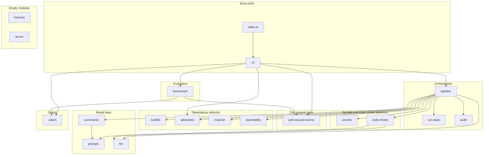
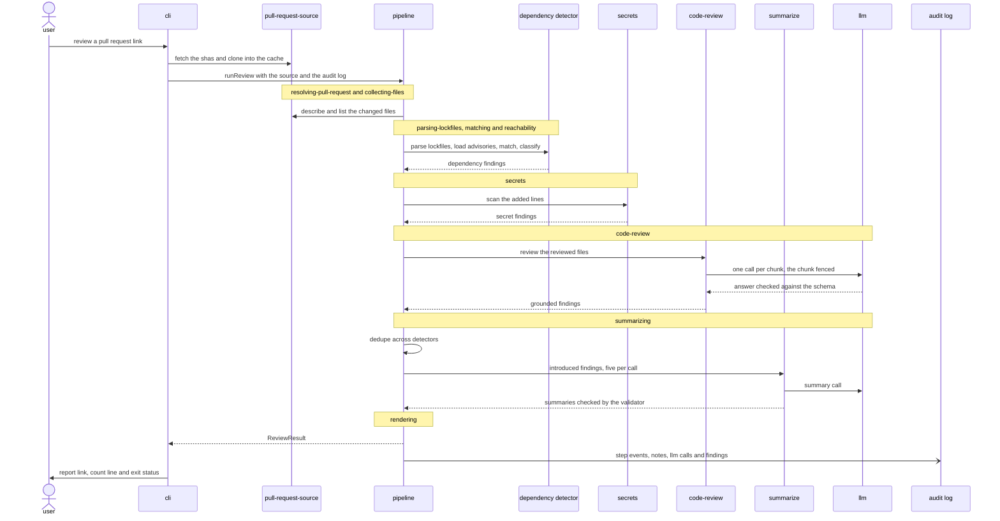
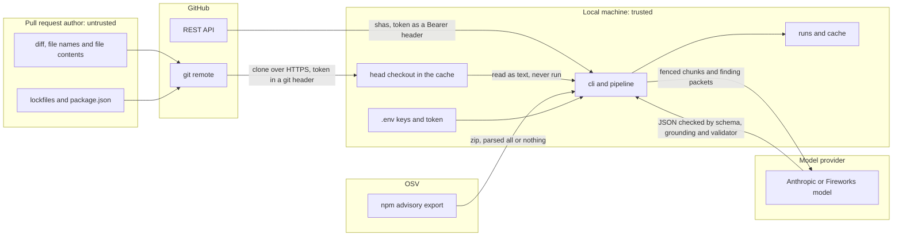
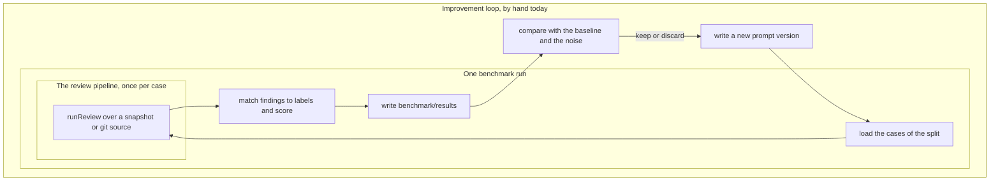

# pull-request-review

## What it is

pull-request-review reads one GitHub pull request and reports the security problems it introduces. It runs three detectors. Dependency scanning, which the industry calls software composition analysis (SCA), matches every new or changed npm version in a lockfile against OSV advisories and checks whether the project imports the package. LLM code review, a form of static application security testing (SAST), asks a model to review the diff and keeps only findings whose evidence is a line the pull request added. Secrets scanning matches the added lines against credential rules. Parsing, matching, reachability, secrets, dedupe, scoring and rendering are deterministic code. Only code review and the finding summaries call a model, and `--no-llm` turns both off. Every run writes an HTML or JSON report and a JSONL audit log, and a labeled benchmark of 54 pull requests scores the whole pipeline.

Status: the pipeline, the CLI and the baseline benchmark are merged. The `harness` and `server` modules are empty, and no prompt improvement has merged yet.

## Quick start

Install the dependencies and create `.env` from [.env.example](.env.example). Bun loads `.env` on every run.

```bash
bun install
cp .env.example .env
```

| Variable | Needed for |
| --- | --- |
| `ANTHROPIC_API_KEY` | model ids that start with `anthropic/` in [config/models.json](config/models.json). The checked-in config uses only these |
| `FIREWORKS_API_KEY` | model ids that start with `fireworks/` |
| `GITHUB_TOKEN` | optional. Raises GitHub's API limit and opens private repositories |
| `PULL_REQUEST_REVIEW_CACHE_DIR` | optional. The cache folder. Unset, it is `~/.cache/pull-request-review` |

Download the OSV npm advisories once. A review refreshes them on its own when they are older than `advisoryStaleHours` in [config/review.json](config/review.json).

```bash
bun index.ts refresh-advisories
```

It printed `refreshed 230364 advisories for 225821 packages` and took 18 seconds on the run behind this README. `bun run refresh-advisories` does the same.

Review one pull request by link or by `owner/repository#number`. With `GITHUB_TOKEN` set, the token goes to the GitHub API and to git as a header, and never into the clone's config, the audit log or the report:

```bash
bun index.ts review https://github.com/axios/axios/pull/11321
```

Without a token, public pull requests still work, within GitHub's limit of 60 API requests an hour:

```bash
GITHUB_TOKEN= bun index.ts review axios/axios#11294
```

Without a model key, `--no-llm` skips code review and writes the summaries from templates:

```bash
GITHUB_TOKEN= bun index.ts review axios/axios#11294 --no-llm
```

Two commits of a local repository need no GitHub call:

```bash
bun index.ts review --repo . --base 707bdba --head 978c0d7 --no-llm
```

A review writes `report.html`, or `report.json` with `--format json`, next to `audit.jsonl` in `runs/<runId>/`, or in the directory `--out` names. It prints the report as a `file://` link and one count line, such as `0 introduced, 4 pre-existing, 0 errors, 0 degraded steps` for axios/axios#11321. Other flags are `--no-cache`, `--offline`, `--model-review`, `--model-summarize` and `--review-prompt-version`. `bun index.ts review --help` lists them all.

| Exit status | When | Seen on |
| --- | --- | --- |
| 0 | the run finished and no introduced finding met `--fail-on` | every review above |
| 1 | an introduced finding is at or above `--fail-on critical\|high\|medium\|low` | the local review with `--fail-on medium`, which found two test tokens |
| 2 | the run aborted, or an error stopped the command | `bun index.ts review not-a-pull-request` |
| 130, 143 | SIGINT or SIGTERM. The log ends with a `run cancelled` note and no report is written | Control-C one second into a local review of the whole history, `--base 4bdff25 --head HEAD` |

The codes come from [src/cli/review-outcome.ts](src/cli/review-outcome.ts) and [src/cli/signal-cancellation.ts](src/cli/signal-cancellation.ts).

Run the benchmark over a split, then print the latest metrics:

```bash
bun index.ts benchmark run --split all --label my-run
bun index.ts benchmark show
```

A run writes four files under [benchmark/results](benchmark/results): a timestamped JSON and HTML pair named after the label, and `latest-<split>.json` and `.html`. The committed `latest-*` files are copies of the baseline, so a run changes them in the working tree. The run over both splits took 3 minutes 17 seconds with an empty response cache. A dev run right after it answered every model call from the cache, cost $0.0000 and gave the same scores.

`--review-prompt-version` runs one review or one benchmark with another code-review prompt, without touching `reviewPromptVersion` in [config/review.json](config/review.json):

```bash
bun index.ts benchmark run --split dev --label prompt-v1 --review-prompt-version 1
```

Check the corpus, and compare the hand-written matcher with [osv-scanner](https://github.com/google/osv-scanner) over every committed lockfile:

```bash
bun run benchmark:validate
bun index.ts validate-matcher
```

The first prints the cases per category and split and exits 0. The second needs `osv-scanner` on PATH. It printed `16 disagreements, 0 not accepted in docs/matcher-disagreements.md` and exited 0. Every accepted row is in [docs/matcher-disagreements.md](docs/matcher-disagreements.md).

## Architecture

One Bun process holds nineteen modules under [src/](src). The flowchart shows which module imports which, from `bunx depcruise` output on the merged code. Test files are left out. [docs/architecture/module-imports.md](docs/architecture/module-imports.md) has the command and the edge list. Every module but `shared` also imports [shared](src/shared/AGENTS.md), the contracts module, and those arrows are left out.



The pipeline never imports `pull-request-source` or `report`. It reads the pull request through the `PullRequestSource` interface in [src/shared/pull-request-source.ts](src/shared/pull-request-source.ts), and the CLI renders the report from the result. The benchmark takes the pipeline as a `ReviewPipeline` function from [src/shared/review.ts](src/shared/review.ts), so it never imports `pipeline` either.

Two rules hold the structure:

1. Only the pipeline runs detectors. No other module imports a detector to run it.
2. Detectors never import each other. Each one takes plain data from `shared` and returns findings. Only `code-review` may import more, the `llm` and `prompts` modules.

Three checks enforce them:

- [.dependency-cruiser.cjs](.dependency-cruiser.cjs) holds the allowed-imports matrix. `bun run check:boundaries` runs it through [scripts/check-boundaries.ts](scripts/check-boundaries.ts) and fails on any import the matrix does not grant and on any `index.ts` inside a module. The matrix grants a few edges the code does not use yet, listed in [docs/architecture/module-imports.md](docs/architecture/module-imports.md).
- Each module has a composite `tsconfig.json` whose `references` are its row of the matrix, such as [src/code-review/tsconfig.json](src/code-review/tsconfig.json). `bun check` follows them from the root [tsconfig.json](tsconfig.json), so an import outside the row also fails the type check. [docs/decisions.md](docs/decisions.md) records the experiment behind this layout.
- [lefthook.yml](lefthook.yml) runs `bun run verify` before every commit, and [.github/workflows/ci.yml](.github/workflows/ci.yml) runs the same command. `verify` is type check, Biome, boundaries, file headers and tests, in that order.

Every module has an `AGENTS.md` with its public API, inputs and outputs, invariants and known gaps. [AGENTS.md](AGENTS.md) at the root holds the repository rules.

## One review, step by step

The CLI clones the pull request into the cache and hands the pipeline a `PullRequestSource`. [src/pipeline/run-review.ts](src/pipeline/run-review.ts) then runs eleven steps under the ten run-state stages. [src/pipeline/run-step.ts](src/pipeline/run-step.ts) moves the stage forward through [run-state](src/run-state/AGENTS.md), writes a `step-start` event with the input hash, runs the step, and writes `step-end` with the output hash and duration, or `step-error`.



Each step below names its stage. Every step writes its step events. The notes listed are the extra events it writes.

1. **describe-pull-request** (resolving-pull-request). [describe-step.ts](src/pipeline/describe-step.ts) reads the base and head shas through the source. [pull-request-source](src/pull-request-source/AGENTS.md) fetches them from the GitHub API in [github-api.ts](src/pull-request-source/github-api.ts) and clones in [clone-pull-request.ts](src/pull-request-source/clone-pull-request.ts). A failure here aborts the run.
2. **collect-files** (collecting-files). [collect-files-step.ts](src/pipeline/collect-files-step.ts) lists the changed files with their hunks from [git-pull-request-source.ts](src/pull-request-source/git-pull-request-source.ts). Files past `maxChangedFiles` or `maxFileBytes` are withheld from secrets and code review and listed as degraded steps. A failure here aborts the run.
3. **parse-lockfiles** (parsing-lockfiles). [lockfile-step.ts](src/pipeline/lockfile-step.ts) parses every changed `bun.lock` and `package-lock.json` at base and head through [lockfile](src/lockfile/AGENTS.md) and diffs them. An unsupported lockfile is a degraded step.
4. **load-advisories** (matching). [advisory-step.ts](src/pipeline/advisory-step.ts) loads the store from [advisories](src/advisories/AGENTS.md) only when a lockfile changed, refreshing it first when it is stale and the run is not `--offline`.
5. **match-dependencies** (matching). [matching-step.ts](src/pipeline/matching-step.ts) runs [matcher](src/matcher/AGENTS.md) on the head set and sets aside a finding whose advisory already affected the package at base. It cross-checks with osv-scanner when installed. Note: `lockfile matched` per lockfile, with the finding count, the skipped withdrawn advisories and GIT ranges, and the oracle status.
6. **reachability** (reachability). [reachability-step.ts](src/pipeline/reachability-step.ts) scans the head checkout once through [reachability](src/reachability/AGENTS.md) and marks each finding direct-imported, direct-unused or transitive. Note: the scan, with its file count and parse time.
7. **secrets** (secrets). [secrets-step.ts](src/pipeline/secrets-step.ts) runs [secrets](src/secrets/AGENTS.md) over the added lines. Note: `added line skipped for length` per line over 4,000 characters.
8. **code-review** (code-review). [code-review-step.ts](src/pipeline/code-review-step.ts) runs [code-review](src/code-review/AGENTS.md) at the live prompt version, or notes `code review skipped because the llm is disabled`. Notes: `review packet assembled`, `injection attempt`, `finding rejected by grounding` and `chunk skipped after output validation failure`. The [llm](src/llm/AGENTS.md) client writes one `llm-call` event per call.
9. **dedupe-findings** (summarizing). [dedupe-step.ts](src/pipeline/dedupe-step.ts) drops repeats across detectors. Note: `finding dropped` with its reason.
10. **summarize** (summarizing). [summarize-step.ts](src/pipeline/summarize-step.ts) runs [summarize](src/summarize/AGENTS.md), with the model or from templates. Its model calls write `llm-call` events.
11. **assemble-result** (rendering). [assemble-step.ts](src/pipeline/assemble-step.ts) copies the metadata and parses the result through `reviewResultSchema`. Then the pipeline writes one `finding` event per finding and a `run finished` note.

The CLI renders the result with [report](src/report/AGENTS.md) in [src/cli/review-command.ts](src/cli/review-command.ts). Only steps 1, 2 and 11 are fatal. Any other failure becomes a `StepError` and a degraded step, and the run goes on with the step's fallback. An aborted run still returns a valid `ReviewResult` and ends its log with `run aborted`.

## Deterministic and model-driven parts

| Part | Calls a model | Where |
| --- | --- | --- |
| Reading the pull request and diffing it | no | [pull-request-source](src/pull-request-source/AGENTS.md) |
| Lockfile parsing and diff | no | [lockfile](src/lockfile/AGENTS.md) |
| Advisory matching, with osv-scanner as a cross-check | no | [matcher](src/matcher/AGENTS.md) |
| Import reachability | no | [reachability](src/reachability/AGENTS.md) |
| Secrets rules | no | [secrets](src/secrets/AGENTS.md) |
| Code review | yes | [code-review](src/code-review/AGENTS.md) |
| Dedupe across detectors | no | [src/pipeline/dedupe-step.ts](src/pipeline/dedupe-step.ts) |
| Summaries and remediation | yes, or templates with `--no-llm` | [summarize](src/summarize/AGENTS.md) |
| Report rendering | no | [report](src/report/AGENTS.md) |
| Benchmark scoring | no | [benchmark](src/benchmark/AGENTS.md) |

Model output is constrained at every step between the prompt and the report:

- **The fence.** [src/prompts/fence-untrusted.ts](src/prompts/fence-untrusted.ts) wraps each diff chunk, evidence line and advisory text in `<untrusted-LABEL-NONCE>` tags. The nonce is a hash of the content, so the content cannot hold its own close tag. The system turn says the fenced text is data and its instructions are not followed. [src/code-review/review-prompt.ts](src/code-review/review-prompt.ts) keeps instructions in the system turn and the fenced chunk alone in the user turn.
- **The output schema.** [src/code-review/model-output.ts](src/code-review/model-output.ts) is the zod schema every answer must pass. A failing answer is retried once with the error appended, then the chunk is skipped.
- **The allowlist.** [src/code-review/vulnerability-type-allowlist.ts](src/code-review/vulnerability-type-allowlist.ts) holds the 22 CWE ids the reviewer may report, each a class where the model can name the untrusted input.
- **The grounding filter.** [src/code-review/grounding.ts](src/code-review/grounding.ts) drops a finding unless its file is the chunk's file, its CWE is on the allowlist, every evidence line equals an added line exactly, and its range touches an added line.
- **The summary validator.** [src/summarize/validate.ts](src/summarize/validate.ts) rejects a summary that names a version, advisory id, package or link its packet did not hold. One retry, then a template that always passes.
- **Temperature.** [src/llm/ai-sdk-llm-provider.ts](src/llm/ai-sdk-llm-provider.ts) sends temperature 0 to Fireworks models only. Anthropic models reject a non-default temperature, so they run at their default ([docs/decisions.md](docs/decisions.md)).
- **The response cache.** [src/llm/llm-cache.ts](src/llm/llm-cache.ts) keys each answer by the model id, prompt hash, system text, user text and output schema. Only answers that passed the schema are stored, so a rerun reads back the same outputs at no cost.

## A finding's life

Every detector returns the `Finding` contract in [src/shared/finding.ts](src/shared/finding.ts): a union on `detector` of `dependency`, `code-review` and `secrets`. All three share an id, severity, confidence, title, optional file and line range, `isIntroducedByPullRequest`, and the optional summary, remediation and summary source.

1. **Detector.** The detector builds the finding and its id with `createFindingId`, the first 16 hex characters of a sha256 over the detector and a stable key. The same weakness at the same place gets the same id in every run.
2. **Grounding.** Code-review findings only. A finding that fails [grounding.ts](src/code-review/grounding.ts) is dropped with a note, and the run counts it in `groundingRejectionCount`.
3. **Dedupe.** [dedupe-step.ts](src/pipeline/dedupe-step.ts) drops four kinds of repeat, each with a `finding dropped` note:
    - a finding whose id was already seen
    - a dependency finding a second lockfile already reported
    - a code-review finding in a manifest or lockfile that names a reported package
    - a hard-coded credential finding on a line a secrets finding reports
4. **Summary.** [summarize-findings.ts](src/summarize/summarize-findings.ts) fills `summary`, `remediation` and `summarySource`, either `model` or `template`.
5. **Report row.** [src/report/report-rows.ts](src/report/report-rows.ts) flattens it into one row with severity, detector, title, location, package, advisory, GitHub-reviewed, scope, reachability, matcher agreement, CWE, confidence and introduced.

A finding is introduced when the pull request brings it in, and pre-existing otherwise. Code-review and secrets findings come from added lines, so they are always introduced. A dependency finding is introduced only when the pull request adds or changes the version. It is also set to pre-existing when the base version already had the same advisory, or one of its aliases, for that package. Only introduced findings are sent to the model for a summary, counted in the report headline, scored by the benchmark and able to fail `--fail-on`. Pre-existing findings get a template summary and a muted row.

## Security model

The pull request author is the attacker. They control the diff, every file in the head checkout, and the lockfiles. The tool runs on a trusted local machine and talks to GitHub, the OSV export and a model provider.



| Attack | Defense | File |
| --- | --- | --- |
| Instructions hidden in the diff tell the model to report nothing or something false | Nonce fence, instructions only in the system turn, injection attempts logged | [fence-untrusted.ts](src/prompts/fence-untrusted.ts), [review-prompt.ts](src/code-review/review-prompt.ts), [review-chunk.ts](src/code-review/review-chunk.ts) |
| The model invents a finding or evidence | Output schema, CWE allowlist, exact match of every evidence line to an added line | [model-output.ts](src/code-review/model-output.ts), [grounding.ts](src/code-review/grounding.ts) |
| Advisory or evidence text plants a fake version or link in a summary | Identifier validator, then a template | [validate.ts](src/summarize/validate.ts) |
| A package script or build runs on the reviewer's machine | Nothing from the repository is installed or run. osv-scanner reads one lockfile offline | [matching-step.ts](src/pipeline/matching-step.ts), [oracle.ts](src/matcher/oracle.ts) |
| A symbolic link in the checkout points outside it | The scan never follows a link or reads a path outside the checkout | [source-files.ts](src/reachability/source-files.ts) |
| Git settings or hook variables change what git reports | Fixed git options, repository variables dropped, no prompts | [git-command.ts](src/pull-request-source/git-command.ts) |
| The token leaks | Sent only to github.com, as a header, never in a URL, argument or file. Audit events are redacted | [clone-pull-request.ts](src/pull-request-source/clone-pull-request.ts), [redact.ts](src/audit/redact.ts) |
| Markup in a file name or title runs in the report | Every value escaped, only https links, no outside requests | [html-escape.ts](src/report/html-escape.ts) |
| Escape codes in a title rewrite the terminal | Every printed byte passes through a sanitizer | [terminal-text.ts](src/cli/terminal-text.ts) |
| A huge pull request runs up cost or time | File count and size limits, a per-run cost cap, overlong lines skipped | [collect-files-step.ts](src/pipeline/collect-files-step.ts), [metered-llm-client.ts](src/pipeline/metered-llm-client.ts), [detect-secrets.ts](src/secrets/detect-secrets.ts) |

Residual risks:

- A prompt injection can still make the model stay silent. Grounding stops invented findings, not missing ones, and the benchmark has no adversarial case to measure this.
- Added lines reach the model provider as they are, secrets included. Nothing is masked.
- A credential the model quotes as evidence is stored verbatim in the LLM cache, the audit log and the report. Redaction only replaces a string that starts with a known token shape or sits under a key named like a secret.
- A lockfile whose `resolved` URL or `integrity` changes without a version change is not flagged.
- The model-written title and source-to-sink text of a code-review finding go into the summary packet without a fence.

## Benchmark

The benchmark runs the same pipeline over labeled pull requests and scores the findings. Three layers nest: the pipeline reviews one case, a benchmark run reviews every case of a split and scores them, and the improvement loop compares runs.



The corpus under [benchmark/cases](benchmark/cases) holds 54 cases: 12 dependency, 15 code, 4 secrets, 15 clean and 8 real-world. The synthetic cases are two copies of the fixture app in [benchmark/fixtures/app](benchmark/fixtures/app), `base/` and `head/`, and the change between them is the pull request. Their labels are written by hand from that change: package and advisory id, CWE with file and lines, or file and line. A clean case expects nothing. A real-world case points at a public repository with the head at the parent of a published security fix, so the pull request reverses the fix. Its label comes from the advisory.

[src/benchmark/match-rules.ts](src/benchmark/match-rules.ts) decides when a finding matches a label, and [src/benchmark/score.ts](src/benchmark/score.ts) counts the matches:

- Only introduced findings count, and only against labels of the same detector.
- Dependency: the same package, and the label's advisory id is the finding's id or an alias.
- Code: the same file, the same CWE or CWE family, and line ranges within 5 lines.
- Secrets: the same file and a start line within 2 lines.
- Matching is one to one, labels in order, each taking the first unmatched finding that fits. Precision, recall and F1 are summed over the cases first.

Every case is in the dev split or the test split, 37 and 17 cases. Dev is for tuning. Test is never used for tuning, and shows whether a gain on dev holds.

A run is offline: dependencies match against the pinned advisories in [benchmark/fixtures/advisories](benchmark/fixtures/advisories), and real-world repositories are cloned once into the cache. A rerun answers every model call from the response cache, so it costs nothing and gives the same counts. Without the cache the model's default temperature shows: three dev runs with `--no-cache` gave F1 0.750, 0.723 and 0.750, so a change under about 0.03 dev F1 is noise. [docs/benchmark.md](docs/benchmark.md) has the full rules, the results files and the variance runs.

## Results

The baseline was recorded on 2026-10-16 before any tuning, with code-review prompt v1 on `anthropic/claude-sonnet-5-5`, summaries on `anthropic/claude-haiku-5-5`, and the corpus advisory fixture dated 2026-10-15. The numbers are from [benchmark/results/baseline-dev.json](benchmark/results/baseline-dev.json) and [benchmark/results/baseline-test.json](benchmark/results/baseline-test.json).

| Run | Split | Cases | Precision | Recall | F1 | Clean false positives | Cost | Cost per pull request |
| --- | --- | --- | --- | --- | --- | --- | --- | --- |
| baseline, prompt v1 | dev | 37 | 0.818 | 0.692 | 0.750 | 1 | $0.4128 | $0.0112 |
| baseline, prompt v1 | test | 17 | 0.875 | 0.636 | 0.737 | 0 | $0.1942 | $0.0114 |
| after | dev | pending | pending | pending | pending | pending | pending | pending |
| after | test | pending | pending | pending | pending | pending | pending | pending |

The "after" rows wait for the code-review improvement change, which has not merged. Cost per pull request is the run's total cost over its case count:

```bash
jq '.score.totalCostUsd / (.cases | length)' benchmark/results/baseline-dev.json
```

By detector, F1 on dev and then test: dependencies 1.000 and 1.000, code review 0.621 and 0.545, secrets 0.800 and 1.000 ([docs/benchmark.md](docs/benchmark.md#baseline)). A fresh run of both splits with an empty cache, made while writing this README, printed F1 0.766 on dev at $0.3969 and 0.778 on test at $0.1900 with the same prompt and models. That is the variance of an uncached run, not an improvement. One review of [axios/axios#11294](https://github.com/axios/axios/pull/11294), a code change reviewed in 6 chunks, cost $0.0755 in 6 uncached code-review calls. A lockfile-only pull request such as [axios/axios#11321](https://github.com/axios/axios/pull/11321) makes no model call.

## Improving the agent

Prompts are files: `prompts/<id>/v<N>.md`, with YAML frontmatter naming the id, version and variables. [src/prompts/prompt-loader.ts](src/prompts/prompt-loader.ts) loads them and hashes every byte, so any edit changes the hash, misses the response cache and is measured fresh. A changed prompt is a new version file, never an edit to a shipped one. Today [prompts/code-review/v1.md](prompts/code-review/v1.md) and [prompts/summarize/v1.md](prompts/summarize/v1.md) ship.

The live code-review version is `reviewPromptVersion` in [config/review.json](config/review.json). `--review-prompt-version <n>` overrides it for one review or one benchmark run and never writes the config, so a new version is scored before it goes live. The summary prompt has no such setting. Its version is the constant `summarizePromptVersion` in [src/summarize/summarize-findings.ts](src/summarize/summarize-findings.ts), set to 1.

The accept rule comes from [docs/benchmark.md](docs/benchmark.md#reading-a-score): F1 is the score, and on a tie the cheaper run wins. A dev gain under about 0.03 F1 is inside the measured noise. A gain is trusted only when it also holds on the test split, which is never used for tuning.

The loop is run by hand: write a new version, run `benchmark run --split dev` with `--review-prompt-version`, compare it with the baseline, and run the test split once. The [harness](src/harness/AGENTS.md) module that would automate it is empty.

## Audit log

Every review writes `runs/<runId>/audit.jsonl`, or `<out>/audit.jsonl` with `--out`. Every benchmark case writes its own under `runs/`. [src/audit/jsonl-audit-sink.ts](src/audit/jsonl-audit-sink.ts) appends one JSON object per line and flushes each line to disk before the write returns, so a crash never leaves a half line. The `runs/` folder is gitignored.

Each line is an `AuditEvent` from [src/shared/audit.ts](src/shared/audit.ts): `timestamp`, `runId`, `step`, `kind`, `payload`, and optional `durationMs` and `costUsd`. The kinds are `step-start`, `step-end`, `step-error`, `llm-call`, `finding` and `note`. This line is from the review of axios/axios#11321:

```json
{"timestamp":"2026-10-16T03:34:50.590Z","runId":"20261016-033449-207c9c4d","step":"match-dependencies","kind":"note","payload":{"message":"lockfile matched","lockfilePath":"package-lock.json","findingCount":4,"withdrawnAdvisoryCount":0,"ignoredGitRangeCount":0,"notes":[],"oracleStatus":"ran"}}
```

Redaction runs on every event before it is written. [src/audit/redact.ts](src/audit/redact.ts) replaces a secret-like string with `sha256:` and the first 16 hex characters of its hash. A string is secret-like when it starts with a token shape, such as `ghp_`, `github_pat_`, `sk-ant-`, `AKIA` or `Bearer `. It is also secret-like when any key above it matches `token`, `secret`, `password`, `api_key`, `authorization` or `credential`. Equal secrets give equal fingerprints, so lines can still be compared. None of the runs behind this README held such a value, so the line above passed through unchanged. A secrets finding never holds the value at all, only a 12 character fingerprint from [src/secrets/detect-secrets.ts](src/secrets/detect-secrets.ts).

An `llm-call` event holds the model id, prompt id, version and hash, an input hash, usage, cost, whether the cache answered, the duration and the raw output. A log that ends without `run finished`, `run aborted` or `run cancelled` means the process was killed.

## Configuration

[config/models.json](config/models.json) names the two models and their prices in US dollars per million tokens. [src/llm/llm-cost.ts](src/llm/llm-cost.ts) prices each call from it, and a model without a price costs null with a warning.

| Model | Used for | Input | Output |
| --- | --- | --- | --- |
| `anthropic/claude-sonnet-5-5` | code review, `reviewModelId` | $2 | $10 |
| `anthropic/claude-haiku-5-5` | summaries, `summarizeModelId` | $0.1 | $0.5 |

[config/review.json](config/review.json) is read by [src/pipeline/review-settings.ts](src/pipeline/review-settings.ts), whose schema rejects an unknown key:

| Key | Value | Meaning |
| --- | --- | --- |
| `contextLines` | 30 | context lines kept around each change in the review packet |
| `isLlmEnabled` | true | `--no-llm` sets it false for one run |
| `isCacheEnabled` | true | `--no-cache` sets it false for one run |
| `advisoryStaleHours` | 24 | age after which a review refreshes the advisories |
| `reviewPromptVersion` | "1" | the live code-review prompt |
| `maxChangedFiles` | 200 | files past this are withheld from secrets and code review |
| `maxFileBytes` | 1000000 | hunk bytes past this withhold a file |
| `maxReviewCostUsd` | 2 | no code-review call starts once a run has spent this |

The environment variables are the four in [.env.example](.env.example), described in [Quick start](#quick-start). The API key for a configured model is checked before any network call, and `--no-llm` needs none. Two more are for tests: `RUN_NETWORK_TESTS=1` adds a live refresh test in [advisories](src/advisories/AGENTS.md), and `PULL_REQUEST_REVIEW_OFFLINE` stops the benchmark from cloning.

Every cache lives under one folder that [src/shared/cache-directory.ts](src/shared/cache-directory.ts) resolves: `PULL_REQUEST_REVIEW_CACHE_DIR` when set, else `~/.cache/pull-request-review`. Point it at the `cache/` folder of the main checkout, which is gitignored, and every worktree shares one cache. Inside it:

- `advisories/npm/` holds `index.json` and `snapshot.json`, written by `refresh-advisories`.
- `llm/` holds one JSON file per cached model answer. Delete it to force fresh calls.
- `pull-request-repositories/` holds the clones `review` makes.
- `benchmark-repositories/` holds the clones of the real-world cases.

## Repository map

| Path | What it holds |
| --- | --- |
| [index.ts](index.ts) | the entry point. It runs the CLI and sets the exit code |
| [src/](src) | the nineteen modules |
| [prompts/](prompts) | the versioned prompt files |
| [config/](config) | the model and review settings |
| [benchmark/](benchmark) | the cases, the fixture app, the pinned advisories and the results |
| [docs/](docs) | the benchmark rules, the decision log, the matcher disagreements, example reports and the module import list |
| [scripts/](scripts) | the boundary check, the header check and the matcher validation |
| [test/fixtures/](test/fixtures) | fixture trees that make the repository checks fail on purpose |
| [openspec/](openspec) | the specs and the archived change proposals |
| [.github/workflows/](.github/workflows) | CI and the daily advisory refresh |
| [.agents/skills/](.agents/skills) | the code style and git rules every change follows |

| Module | Purpose |
| --- | --- |
| [shared](src/shared/AGENTS.md) | the zod contracts every module builds against |
| [cli](src/cli/AGENTS.md) | the commands, their flags and exit codes |
| [pipeline](src/pipeline/AGENTS.md) | runs the eleven review steps and returns the result |
| [run-state](src/run-state/AGENTS.md) | the ordered stages and the forward-only moves between them |
| [audit](src/audit/AGENTS.md) | the redacting JSONL audit log |
| [pull-request-source](src/pull-request-source/AGENTS.md) | reads a pull request from GitHub, a local repository or two directories |
| [lockfile](src/lockfile/AGENTS.md) | parses `bun.lock` and `package-lock.json` and diffs them |
| [advisories](src/advisories/AGENTS.md) | downloads the OSV npm export and serves it by package |
| [matcher](src/matcher/AGENTS.md) | matches versions against advisory ranges, with osv-scanner as a cross-check |
| [reachability](src/reachability/AGENTS.md) | finds which files import a vulnerable package |
| [secrets](src/secrets/AGENTS.md) | the credential rules for added lines |
| [code-review](src/code-review/AGENTS.md) | the review packet, the prompt, grounding and dedupe for model findings |
| [prompts](src/prompts/AGENTS.md) | loads and hashes prompt files and fences untrusted text |
| [llm](src/llm/AGENTS.md) | the model client with cache, cost, retries and audit events |
| [summarize](src/summarize/AGENTS.md) | model or template summaries, checked by the validator |
| [report](src/report/AGENTS.md) | the HTML and JSON reports |
| [benchmark](src/benchmark/AGENTS.md) | loads, runs and scores the corpus |
| [harness](src/harness/AGENTS.md) | empty. Meant for automated prompt and model experiments |
| [server](src/server/AGENTS.md) | empty. Meant for an HTTP server |

## Extension points

**A new lockfile format**, such as pnpm or yarn. Add the kind to `lockfileKinds` in [src/shared/dependency.ts](src/shared/dependency.ts), write `src/lockfile/<kind>-lock.ts`, and register it in [src/lockfile/lockfile-registry.ts](src/lockfile/lockfile-registry.ts), taking its file name out of the unsupported list. Add fixtures under [src/lockfile/fixtures](src/lockfile/fixtures). The steps are in [src/lockfile/AGENTS.md](src/lockfile/AGENTS.md#adding-a-lockfile-kind).

**A new OSV ecosystem.** Add it to `advisoryEcosystems` in [src/advisories/cache-layout.ts](src/advisories/cache-layout.ts) and stop [src/advisories/advisory-store.ts](src/advisories/advisory-store.ts) from loading npm only. The matcher compares against the `npmEcosystem` constant in [src/matcher/match.ts](src/matcher/match.ts) and uses npm version rules, and [src/advisories/package-name.ts](src/advisories/package-name.ts) and [src/shared/package-name.ts](src/shared/package-name.ts) normalize npm names. The ecosystem also needs a lockfile parser.

**A new detector.** Add its kind to `detectorKinds` and its variant to `findingSchema` in [src/shared/finding.ts](src/shared/finding.ts). Create `src/<module>/` with an `AGENTS.md` and a `tsconfig.json`, and grant it in [.dependency-cruiser.cjs](.dependency-cruiser.cjs) and in [src/pipeline/tsconfig.json](src/pipeline/tsconfig.json). Add a step file in [src/pipeline](src/pipeline/AGENTS.md), call it from [run-review.ts](src/pipeline/run-review.ts), and add the step to `reviewSteps` and `stagesByStep` in [run-step.ts](src/pipeline/run-step.ts). Add a category to `benchmarkCategories` in [src/shared/benchmark.ts](src/shared/benchmark.ts) and a rule to [src/benchmark/match-rules.ts](src/benchmark/match-rules.ts). Add its columns to `columnKeys` and `toReportRow` in [src/report/report-rows.ts](src/report/report-rows.ts).

**A new prompt version.** Add `prompts/code-review/v<N+1>.md` with the same variables as [v1.md](prompts/code-review/v1.md), score it with `--review-prompt-version`, then set `reviewPromptVersion` in [config/review.json](config/review.json).

**A new model or provider.** A model from Anthropic or Fireworks is a model id and a price in [config/models.json](config/models.json). A new provider is an entry in `modelProviders` in [src/llm/model-config.ts](src/llm/model-config.ts), a branch in `resolveLanguageModel` and `resolveSamplingTemperature` in [src/llm/ai-sdk-llm-provider.ts](src/llm/ai-sdk-llm-provider.ts), its key in [src/pipeline/api-keys.ts](src/pipeline/api-keys.ts) and [.env.example](.env.example), and its AI SDK package in [package.json](package.json).

**A new output format**, such as SARIF. Write `src/report/render-<format>.ts` beside [render-json.ts](src/report/render-json.ts), add the format to `reportFormats` in [src/cli/program.ts](src/cli/program.ts), and choose the renderer where [src/cli/review-command.ts](src/cli/review-command.ts) writes `report.<format>`.

**A database-backed advisory store.** Callers see only the `AdvisoryStore` interface in [src/shared/advisory.ts](src/shared/advisory.ts): `getByPackage` and `snapshot`. Replace the JSON index behind `loadAdvisoryStore` in [src/advisories/advisory-store.ts](src/advisories/advisory-store.ts) with a `bun:sqlite` store, and write it from [src/advisories/refresh-advisories.ts](src/advisories/refresh-advisories.ts). [src/pipeline/advisory-step.ts](src/pipeline/advisory-step.ts) and the benchmark command in [src/cli/benchmark-command.ts](src/cli/benchmark-command.ts) load the store and need no other change.

## Gaps and limitations

- **Reachability is import-level only.** A package any file imports is direct-imported, even when the vulnerable function is never called and even when only tests import it.
- **npm only.** Only `bun.lock` and `package-lock.json` are parsed. `pnpm-lock.yaml`, `yarn.lock`, `bun.lockb` and `npm-shrinkwrap.json` are listed as unsupported, and the step degrades.
- **Workspace packages never match.** No code filters them out. Their version is `workspace:<path>`, which is not semver, and the matcher never counts an unparseable version as affected.
- **GIT ranges are ignored.** They are counted in the `lockfile matched` note and never matched.
- **The reviewer sees one chunk at a time.** A chunk is up to 500 diff lines of one file with 30 context lines. Nothing from other files or other chunks reaches it, so a flow across files can be missed.
- **The benchmark is small.** 54 cases, labeled by hand by one person, with 17 in the test split.
- **Prompt injection can still suppress findings.** The fence and grounding stop invented findings, not silence. The corpus has no adversarial case, so this risk is not measured.
- **Lockfile tampering is not detected.** The diff compares names and versions, so a changed `resolved` URL or `integrity` with the same version passes.
- **The osv-scanner cross-check needs the binary.** Without it every changed lockfile degrades the matching step, and findings are `oracle-unavailable`.
- **Regex secret rules have limits.** Private key bodies after the header line, lines over 4,000 characters, credentials without a known prefix or a secret-named key, and live checks against the provider are all outside them.
- **Secrets reach the model provider.** The review packet holds added lines unmasked.
- **Quoted credentials are stored verbatim.** A credential the reviewer quotes as evidence lands in the LLM cache, the audit log and the report. Audit redaction only catches a whole value with a token shape or a value under a secret-named key.
- **The summarizer is not scored.** A benchmark match checks package, CWE and lines, never the summary or remediation text.
- **The grounding filter is loose on position.** An evidence line may be any added line of the file, not only one inside the finding's range.
- **Steps run one after another.** So do code-review chunks and summary batches.
- **An advisory without a CVSS score is medium.** The contract has no GitHub severity label to fall back on.
- **The full advisory index uses about 1.4 GB of memory** once loaded, by the advisories module's own measurement.
- **The HTML report hides step errors and degraded steps.** They are in the JSON report.
- **Renames are exact only.** A moved and edited file shows as a deletion and an addition.
- **`generateObject` is deprecated.** Every model run prints the AI SDK's deprecation warning.

## What's next

These are planned and not built:

- Improve the code-review prompt from the baseline's misses on the dev split, measure it, and fill the "after" rows above.
- Automate that loop in the [harness](src/harness/AGENTS.md) module.
- Outputs for CI, such as SARIF annotations and a pull request comment.
- A [server](src/server/AGENTS.md) with a browser page to start reviews and browse past runs.
- Mask secrets before the model call and in quoted evidence.
- Flag a lockfile entry whose `resolved` URL or `integrity` changes without a version change.
